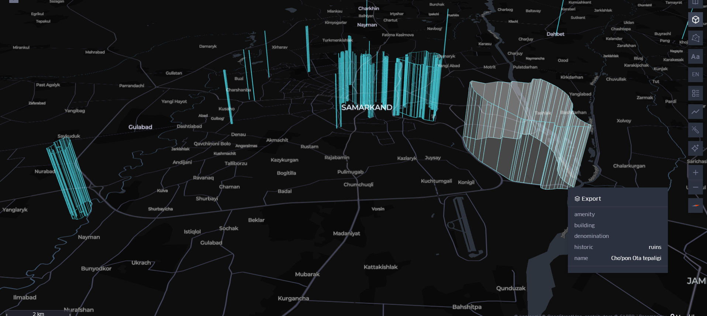

# 🗺️ Day 03: Polygons - Samarkand Historic Footprints

A futuristic, high-contrast 3D polygon visualization exploring the majestic architecture, ancient madrasahs, and historic monuments in the heart of **Samarkand, Uzbekistan** 🇺🇿✨

  

---

## 📊 Technical Workflow & Methodology

### 1. Data Querying & Extraction
Geospatial data was queried and extracted using the **Overpass Turbo** (OpenStreetMap API). The search targeted precise spatial polygonal geometries (`ways` and `relations`) explicitly tagged under cultural, historic, and architectural infrastructure inside Samarkand.
* **Output Format:** Clean `.geojson` spatial layer.

### 2. Cartography & 3D Extrusion (Kepler.gl)
* **Canvas Style:** Set to **Dark Matter** base layer to hide secondary road clutter and provide high visual contrast for fluorescent data layers.
* **3D Configuration:** Activated the **3D Extrusion Layout** with a highly structural setting:
  * **Height / Elevation Scale:** Balanced at `4` to prevent vertical spike distortions.
  * **Stroke Width:** Tuned to `5.07` to give the walls a thick, solid volumetric presence rather than hollow wireframes.
* **Color Palette:** Styled in bright neon **Cyan / Turquoise** to echo the historic turquoise domes of Samarkand's heritage.

### 3. Immersive Interaction
* Developed interactive **Tooltips** using Kepler's Interaction Toolkit. 
* Hovering over any structural body reveals its verified local name (`name`) or descriptive category (`historic`) dynamically.

---

## 📂 Folder Directory
* 📁 `export.geojson`: The core geospatial vector layer containing Samarkand's architectural polygon data.
* 🖼️ `Polygons_Samarkand.png`: The final exported high-resolution 3D cartographic rendering.
* 📄 `README.md`: This documentation sheet.

---
*Developed independently as part of the global #30DayMapChallenge.*
