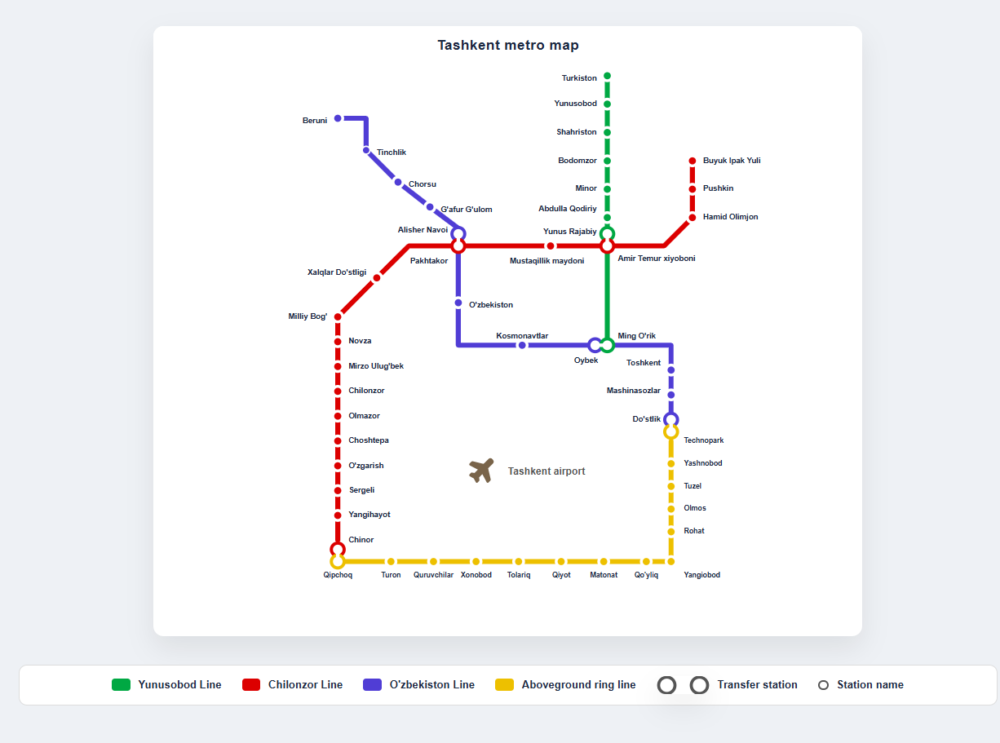

# 🤖🗺️ Day 10: Prompting Only — Tashkent Metro Schematic Map

A clean, official-style schematic diagram of the **Tashkent Metro** network in Uzbekistan, built **100% through iterative AI prompting**—with zero manual drawing and zero hand-written code 🇺🇿✨

  

---

## 🛠️ Workflow & Rules Followed
* **Tools Used:** AI Assistant (VS Code AI / Chat) + HTML5 / SVG rendered directly in the browser.
* **Strict Rule:** Every layout change, coordinate correction, station addition, and styling fix was achieved exclusively by writing follow-up prompts—never by manually editing HTML/SVG code.

---

## 📝 Iterative Prompt Log (How the Map Evolved)

### Prompt 1 — Initial Geographic Map Attempt
> *"Create a complete, single-file interactive web map of the Tashkent Metro system in Uzbekistan using HTML and Leaflet.js with all 4 metro lines (Chilonzor Red, Oʻzbekiston Blue, Yunusobod Green, Circle Line Yellow), transfer stations, popups, and a dark basemap."*
* **Result & Fact-Check:** Generated a Leaflet map, but OpenStreetMap tiles returned a `403 Access blocked` error on local files, and the schematic layout needed cleaner visual structure.

### Prompt 2 — Switching to a Schematic SVG Diagram
> *"Build a clean schematic diagram inspired by the official Tashkent Metro map on a 1000×860 SVG canvas using straight horizontal, vertical, and 45-degree lines with exact (x, y) station coordinates for all 4 lines, transfer connectors, and a bottom legend."*
* **Result & Fact-Check:** Untangled the lines into a clear schematic grid, though transfer capsules were off-center and several labels overlapped.

### Prompt 3 — Linked-Ring Transfer Icons & Label Collision Fixes
> *"Replace the white transfer capsules with official linked-ring connectors (two colored rings joined by an inner white bridge). Move upper-left Blue line labels and lower-left Red line labels to the inside of the lines, rename Mustaqillik maydoni, and remove extra corner dots."*
* **Result & Fact-Check:** Eliminated label collisions and matched the official linked-ring interchange style.

### Prompt 4 — Adding Missing Stations & Uzbek Spellings
> *"Add the missing station dot for Tinchlik, stack the Yunus Rajabiy and Amir Temur xiyoboni transfer rings vertically, insert Yashnobod station between Technopark and Tuzel on the Yellow line, and update Kipchak to Uzbek spelling (Qipchoq)."*
* **Result & Fact-Check:** Completed the full station roster across all four lines.

### Prompt 5 — Final Spacing, Airport Icon & Viewport Fit
> *"Remove the background grid squares for a pure white canvas, keep only the commercial airplane icon for Tashkent airport, align Yangiobod with the bottom horizontal Yellow line, increase spacing around Abdulla Qodiriy and Yashnobod, and scale the SVG to fit inside one screen height."*
* **Result:** Produced the final balanced schematic shown above.

---

## 📂 Folder Directory
* 🖼️ `Tashkent_Metro_Schematic.png`: Final exported schematic map screenshot.
* 🌐 `tashkent_metro.html`: AI-generated single-file HTML/SVG source code.
* 📄 `README.md`: Project overview and full prompt log.

---

## 🙏 Credits & Inspiration
* **Schematic Design Reference:** Official Tashkent Metro map layout (`tashmetro.uz` / `Voyage.uz`).
* **AI Workflow:** Generated and refined iteratively via AI prompting in VS Code.

*Developed independently as part of the global #30DayMapChallenge.*
