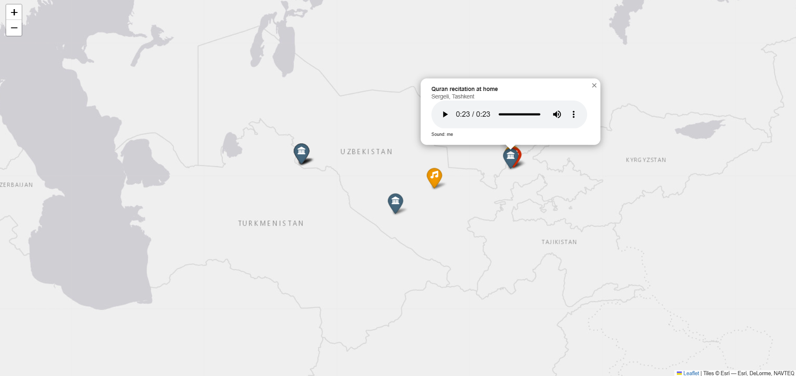

# 🔊🗺️ Day 11: Sound — A Map of Uzbekistan You Can Listen To

An interactive audio-cartography map of **Uzbekistan** built with **Python** and **Folium**, where clicking any location pin opens an embedded audio player—combining CC0 field recordings from **Freesound** with a personal home recording from **Sergeli, Tashkent** 🇺🇿✨

  

---

## 📊 Technical Workflow & Audio Mapping

### 1. Interactive Map Architecture (`Python` & `Folium`)
* **Cartographic Engine:** Generated locally in Jupyter Notebook using `folium` over **Esri World Light Gray Canvas** basemap tiles centered on Uzbekistan.
* **Categorized Symbology:** Color-coded markers and icons by acoustic theme:
  * 🟠 **Music:** Traditional instruments and performances (*Karnay*, *Dutor*, *Khiva Musicians*).
  * 🔴 **Street:** Vibrant bazaars and historic urban soundscapes (*Bird market in Tashkent*, *Itchan Kala*).
  * 🔵 **Monument & Spiritual:** Architectural and sacred soundscapes (*Chor-Bakr*, *Juma Mosque in Khiva*, *Quran recitation at home*).

### 2. Cloud Audio & Base64 Self-Contained Embedding
* **Freesound Integration:** Embedded interactive iframe players for CC0-licensed field recordings across Tashkent, Bukhara, Khiva, and the Kyzylkum Desert.
* **Personal Field Recording (Offline-Ready):** Recorded Quran recitation playing on TV at home in **Sergeli, Tashkent** (`.ogg`), encoded into a **Base64 data URI** directly inside `sound_map.html` so the HTML5 `<audio>` player works offline without external hosting.

---

## 🎧 Featured Sound Locations
1. **Bird Market** — Bazaar in Tashkent *(Street · Freesound CC0 by `ali.g`)*
2. **Karnay** — Tashkent *(Music · Freesound CC0 by `artemditkovsky`)*
3. **Chor-Bakr Memorial Complex** — Near Bukhara *(Monument · Freesound CC0 by `selcukartut`)*
4. **Itchan Kala** — Khiva *(Street · Freesound CC0 by `selcukartut`)*
5. **Children in the Juma Mosque** — Khiva *(Monument · Freesound CC0 by `selcukartut`)*
6. **Dutor in a Yurt Camp** — Kyzylkum Desert *(Music · Freesound CC0 by `bassimat`)*
7. **Khiva Musicians Playing in a Restaurant** — Khiva *(Music · Freesound CC0 by `selcukartut`)*
8. **Quran Recitation at Home** — Sergeli, Tashkent *(Personal Recording · Base64 Embedded)*

---

## 📂 Folder Directory
* 📓 day11_sound_map.ipynb: Complete Jupyter Notebook with step-by-step code.
* 🌐 `sound_map.html`: Self-contained interactive Folium map (download and open in any browser to listen).
* 📄 `README.md`: Project overview and attribution sheet.

---

## 🙏 Credits & Attribution
* **Field Recordings (CC0):** Freesound contributors `ali.g`, `artemditkovsky`, `selcukartut`, and `bassimat`.
* **Personal Recording:** Recorded in Sergeli, Tashkent.
* **Basemap & Tools:** Esri World Light Gray Canvas (`Esri, DeLorme, NAVTEQ`), Python, and Folium.

*Developed independently as part of the global #30DayMapChallenge.*
