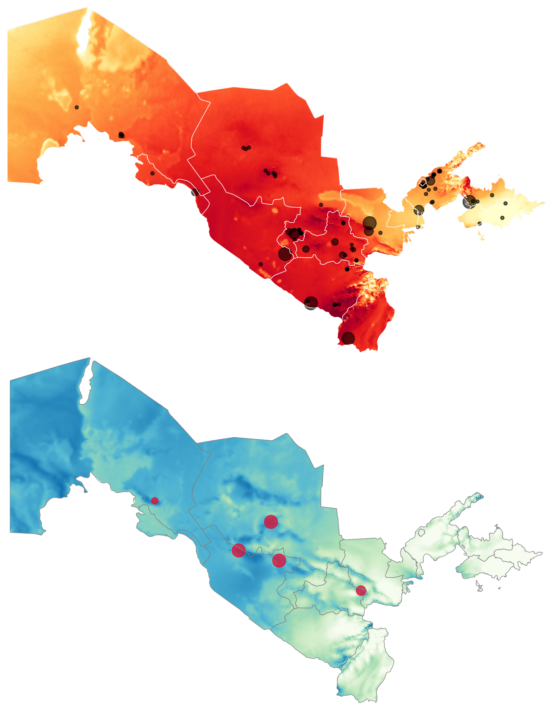

# ☀️💨 Day 12: Power — Where Is the Sun and Wind Strongest in Uzbekistan?

A geospatial raster analysis evaluating whether **Uzbekistan's** rapidly expanding solar and wind power farms were built in the country's highest-potential locations—combining **World Bank Global Solar & Wind Atlas** rasters with **OpenStreetMap** power plant infrastructure using **Python**, `rasterio`, and `rasterstats` 🇺🇿⚡

  

---

## 📊 Key Findings & Spatial Analysis

### 1. Solar Power Potential (`PVOUT` — kWh / kWp / year)
* **National Range:** Solar photovoltaic potential spans from **939** to **1,772 kWh/kWp/year** (national average: **1,551 kWh/kWp/year**).
* **Sunniest Regions:** **Bukhara** (`1,626.6`), **Kashkadarya** (`1,622.1`), **Samarkand** (`1,618.4`), and **Navoi** (`1,596.3`) lead the country, whereas mountainous areas and the Ferghana Valley (**Andijan** at `1,360.6`) receive less due to cloud cover and terrain shading.
* **Solar Farm Placement:** Major utility-scale projects like **Navoi Hybrid Solar (300 MW)** and **Nishon Solar (500 MW)** sit in pixels sunnier than **95%** of Uzbekistan, while plants closer to load centers (such as **Boʻka 260 MW** near Tashkent or **Pop 500 MW** in Namangan) trade peak irradiance for proximity to cities and existing transmission grids.

### 2. Wind Power Potential (`100 m` Hub Height — m/s)
* **National Range:** Mean wind speed at 100 m averages **6.5 m/s**, reaching up to **11.9 m/s** in the windiest corridors.
* **Windiest Regions:** **Karakalpakstan** (`7.6 m/s`), **Bukhara** (`7.3 m/s`), and **Navoi** (`6.8 m/s`) dominate wind potential across the Ustyurt Plateau and Kyzylkum Desert, while Tashkent and the Ferghana Valley remain calm (`2.7–3.7 m/s`).
* **Wind Farm Placement:** Four of Uzbekistan's five utility-scale wind farms sit in the **top 20% windiest** locations nationwide, led by **Dzhankeldi Wind Farm (500 MW, 8.64 m/s — 100th percentile)** and **Zarafshon Wind Farm (500 MW, 8.27 m/s — 97th percentile)**.

### 3. Power Infrastructure Overview (189 Mapped Plants)
* **By Count:** `99` Solar · `61` Hydro · `19` Gas · `5` Wind · `4` Coal · `1` Nuclear (under construction near Jizzakh).
* **By Total Capacity:** Gas thermal plants still provide the backbone of installed capacity (~**14,000 MW**, led by **Syrdarya Thermal Power Plant** at **3,000 MW**), followed by solar (~**4,000 MW**) and wind (~**1,850 MW**).

---

## 🛠️ Technical Workflow (`Python`)
* **Raster Processing (`rasterio`):** Loaded 1 km resolution GeoTIFF grids (`solar_pvout.tif` and `wind_speed_100m.tif`) and extracted exact pixel values beneath each power plant coordinate via `raster.sample()`.
* **Zonal Statistics (`rasterstats`):** Aggregated pixel-level solar and wind potential across all 14 administrative regions (`uzbekistan_regions.geojson`) using `zonal_stats()`.
* **Cartography (`matplotlib` & `geopandas`):** Rendered a two-panel vertical layout (`YlOrRd` for solar PVOUT, `GnBu` for 100 m wind speed) overlaid with proportional power plant markers scaled by megawatt capacity.

---

## 📂 Folder Directory
* 🖼️ `power_map.png`: Stacked vertical map comparing solar potential (top) and wind speed (bottom) with utility power plants.
* 📓 `day12_sun_and_wind.ipynb`: Complete Python Jupyter Notebook with raster sampling and zonal statistics.
* 📄 `README.md`: Project documentation and spatial findings.

---

## 🙏 Credits & Attribution
* **Solar Data:** Global Solar Atlas 2.0, developed and operated by Solargis s.r.o. on behalf of the World Bank Group, with funding from ESMAP (© 2019 The World Bank, **CC BY 4.0**). Layer: `PVOUT`, long-term yearly average.
* **Wind Data:** Global Wind Atlas 3.0, developed, owned, and operated by the Technical University of Denmark (DTU) in partnership with the World Bank Group, with funding from ESMAP (**CC BY 4.0**). Layer: mean wind speed at `100 m`.
* **Power Plants:** © OpenStreetMap contributors (**ODbL**), queried November 2026 (`power=plant`).
* **Administrative Boundaries:** Uzbekistan regional boundaries (`simplemaps.com`, simplified).

*Developed independently as part of the global #30DayMapChallenge.*

