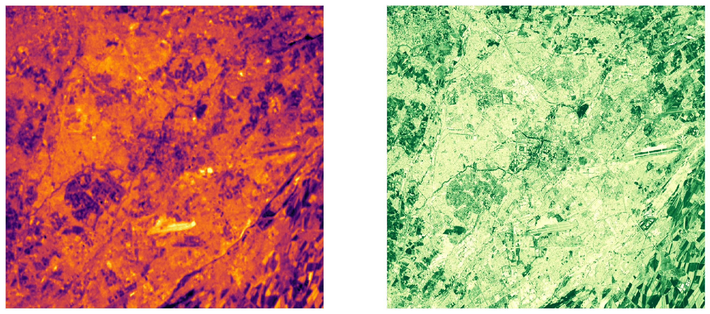

# 🌳🔥 Day 13: Interactions — Trees and Heat in Tashkent

A satellite thermal and vegetation analysis measuring the urban cooling effect across **Tashkent, Uzbekistan**—comparing **Land Surface Temperature (`°C`)** and **NDVI (greenness)** across 800,000 pixels from **Landsat 8** via **STAC** and the **Microsoft Planetary Computer** 🇺🇿🛰️

  

---

## 📊 Key Findings & Urban Heat Interaction

### 1. City-Wide Surface Temperature (`28 July 2026, 11:04 Local Time`)
* **Satellite Scene:** Cloud-free **Landsat 8 Collection 2 Level-2** (`LC08_L2SP_154031_20260728_02_T1`, `0.05%` cloud cover, `30 m × 30 m` resolution).
* **Temperature Range:** Land surface temperatures across Greater Tashkent ranged from **24.0 °C** (water bodies and dense shade) up to **59.0 °C** (dark asphalt, metal roofs, and airport runways), with a city-wide average of **43.0 °C**.

### 2. Greenness vs. Heat Correlation (`r = -0.68`)
* **Strong Negative Correlation:** Across ~800,000 land pixels, NDVI and surface temperature show a strong inverse correlation of **`-0.68`**—the greener the surface, the cooler the ground.
* **7.5 °C Tree Cooling Effect:**
  * **Bare / Built-up (`NDVI 0.0–0.2`):** **45.1 °C** average
  * **Light Vegetation (`NDVI 0.2–0.4`):** **43.5 °C** average
  * **Green Areas (`NDVI 0.4–0.6`):** **40.9 °C** average
  * **Dense Trees (`NDVI 0.6+`):** **37.6 °C** average

### 3. Landmark & Campus Comparison (`90 m × 90 m` Windows)
* **Botanical Garden (`NDVI 0.71`):** **35.5 °C** *(Coolest)*
* **Japanese Garden (`NDVI 0.77`):** **36.5 °C**
* **Tashkent City Park (`NDVI 0.54`):** **38.7 °C**
* **Turin Polytechnic University in Tashkent:** Sampled campus thermal and vegetation profile
* **Chilonzor Metro (`NDVI 0.12`):** **45.4 °C**
* **Chorsu Bazaar (`NDVI 0.11`):** **47.9 °C**
* **Tashkent International Airport (`NDVI 0.25`):** **54.3 °C** *(Hottest — 18.8 °C hotter than the Botanical Garden at the exact same moment)*

---

## 🛠️ Technical Workflow (`Python`)
* **Cloud-Native Data Access (`pystac-client` & `planetary-computer`):** Queried the Microsoft Planetary Computer STAC catalog (`landsat-c2-l2`) and streamed only the Tashkent bounding box (`[69.10, 41.20, 69.45, 41.42]`) in **`EPSG:32642` (WGS 84 / UTM zone 42N)** using `odc-stac`.
* **Thermal & Radiometric Calibration (`xarray`):** Converted raw Landsat thermal infrared (`lwir11`) numbers to Celsius (`DN × 0.00341802 + 149.0 - 273.15`) and surface reflectance bands (`red`, `nir08`) to NDVI (`(NIR - Red) / (NIR + Red)`).
* **Visualization (`matplotlib`):** Rendered side-by-side spatial comparisons using `inferno` for surface heat (`30–55 °C`) and `YlGn` for vegetation density (`0.0–0.8`).

---

## 📂 Folder Directory
* 🖼️ `trees_and_heat.png`: High-resolution side-by-side map of Tashkent's surface temperature (left) and NDVI greenness (right).
* 📓 `day13_trees_and_heat.ipynb`: Complete Python Jupyter Notebook with STAC search, raster math, and landmark sampling.
* 📄 `README.md`: Project documentation and thermal analysis summary.

---

## 🙏 Credits & Attribution
* **Satellite Data:** Landsat 8 Collection 2 Level-2 (`LC08_L2SP_154031_20260728_02_T1`) courtesy of the **U.S. Geological Survey (USGS)** and NASA.
* **Data Access:** **Microsoft Planetary Computer** STAC API (`landsat-c2-l2`).
* **Software:** Python (`pystac-client`, `planetary-computer`, `odc-stac`, `xarray`, `matplotlib`, `pyproj`, `pandas`).

*Developed independently as part of the global #30DayMapChallenge.*
