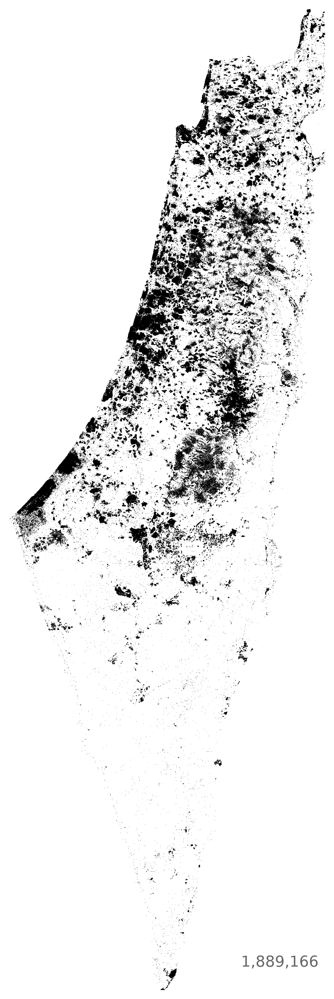

# 🏛️🗺️ Day 14: Borgesian Map — Every Building in Palestine

Inspired by Jorge Luis Borges' 1946 short story *On Exactitude in Science* (*Del rigor en la ciencia*), this map plots **1,889,166 mapped buildings across Historic Palestine as individual black dots—with **no basemap, no administrative divisions, and no roads**, letting the geography of the land emerge purely from human settlement density 🇵🇸✨

  

---

## 📊 Technical Workflow & Spatial Querying

### 1. Cloud-Native Building Data (`Overture Maps` & `DuckDB`)
* **Dataset:** Streamed directly from **Overture Maps Foundation** (`release 2026-10-21.0`, `theme=buildings`), which merges AI-detected satellite building footprints (Microsoft & Google) with volunteer-mapped **OpenStreetMap** buildings.
* **SQL Cloud Filtering (`DuckDB`):** Used DuckDB's `httpfs` and `spatial` extensions to query **1,889,166** building centroids (`lon`, `lat`), spheroid roof surface areas (`ST_Area_Spheroid`), and data sources directly from cloud Parquet storage.

### 2. Geographic Clipping & Cartographic Projection
* **Exact Territory Clipping (`GeoPandas`):** Clipped the building centroids to the full geographic silhouette of Historic Palestine from the Mediterranean Sea to the Jordan River, Sea of Galilee, and Gulf of Aqaba (`lon <= 35.63`, `lat 29.45–33.38`).
* **Scale-Adaptive Rendering (`Matplotlib`):** Plotted dense northern and central urban areas with fine points (`s=0.06`) and sparse southern Naqab settlements with boosted dot visibility (`s=0.35`) at an aspect ratio of `1.17` (`1 / cos(31.5°N)`), framing the entire territory down to its southern tip.
* **Emergent Geography:** Purely from building density, the Mediterranean coastline, the **Gaza Strip**, the **Jerusalem–Ramallah–Nablus** highland ridge, the **Galilee**.

---

## 📂 Folder Directory
* 🖼️ `palestine_every_building.png`: Optimized high-resolution Borgesian map of **1,889,166** buildings in Palestine.
*  🇵🇸 `palestine_buildings.py`: Python script with DuckDB SQL queries, GeoPandas spatial clipping, and Matplotlib rendering.
* 📄 `README.md`: Project documentation and data attribution.

---

## 🙏 Credits & Attribution
* **Building Footprints:** © **Overture Maps Foundation** (release `2026-10-21.0`), licensed under **ODbL**, including © **OpenStreetMap** contributors and **Microsoft ML Building Footprints**.
* **Geographic Boundaries:** Natural Earth (`10m` cultural vectors).
* **Literary Inspiration:** Jorge Luis Borges, *Del rigor en la ciencia* (*On Exactitude in Science*), 1946.
* **Software:** Python (`duckdb`, `geopandas`, `matplotlib`).

*Developed independently as part of the global #30DayMapChallenge.*
