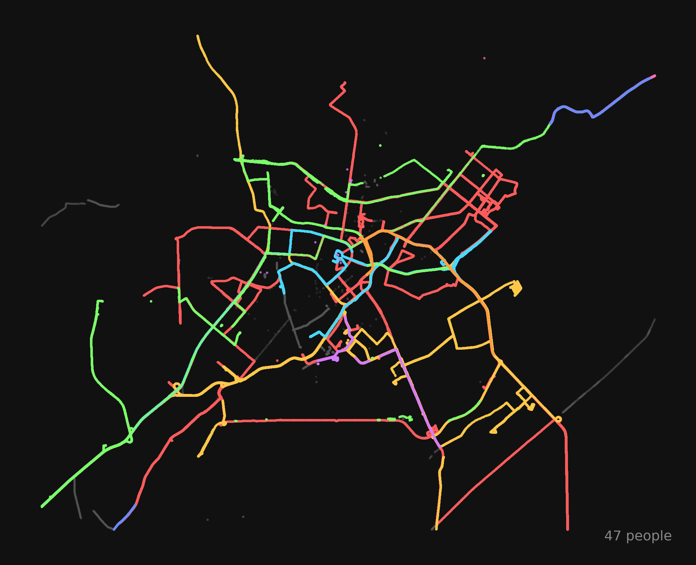

# 🤝🗺️ Day 16: Collaborative Map — Tashkent Through Strangers' Eyes

A crowdsourced street-level mapping analysis of **Tashkent, Uzbekistan**, visualizing **107,288 geolocated street photos** captured across **877 walks and drives** by **47 independent Mapillary contributors** who never met—yet collaboratively built a shared visual map of the city 🇺🇿📸

  

---

## 📊 Key Findings & Contributor Insights

### 1. Crowdsourced Coverage (`107,288` Street Photos)
* **Dataset:** Analyzed `tashkent_photos.parquet` covering Greater Tashkent (`69.12–69.45°E`, `41.20–41.40°N`), containing coordinates, capture dates, sequence IDs, and contributor usernames.
* **47 Independent Contributors:** Across **877 separate walks and drives**, three prolific mappers contributed the largest share of imagery (`sirojiddin520` with **44,853** photos, `Muhammadjon` with **24,572**, and `lvl5` with **14,748**), while dozens of other contributors added hundreds of smaller neighborhood sequences.

### 2. Visual & Temporal Patterns
* **One Colour Per Person (`Matplotlib`):** Assigned each of the top 8 contributors a distinct colour (`#e4572e`, `#2e86ab`, `#56a3a6`, etc.) against a dark canvas (`#111111`), revealing how individual routes intersect along major avenues while smaller *mahalla* side streets remain open for future community mapping.
* **Multi-Year Growth:** Temporal grouping (`photos["date"].str[:4]`) shows major mapping surges in **2018**, **2022**, **2025**, and **2026**, enabling multi-year street-level change detection.
* **Interactive Trail Explorer (`Folium`):** Built an interactive sequence map over **Esri World Gray Canvas** where clicking any route displays the contributor's username, date, photo count, and a direct link to inspect the street sequence on Mapillary.

---

## 📂 Folder Directory
* 🖼️ `tashkent_together.png`: High-resolution (`300 DPI`) dark-canvas map colour-coded by contributor.
* 📓 `day16_street_photos.ipynb`: Complete Python Jupyter Notebook with `pandas`, `matplotlib`, and `folium` analysis.
* 📄 `README.md`: Project documentation and data attribution.

---

## 🙏 Credits & Attribution
* **Street-Level Photos & Metadata:** © **Mapillary contributors**, licensed under **CC BY-SA 4.0** (queried November 2026 via Mapillary API).
* **Interactive Basemap:** Esri World Gray Canvas.
* **Software:** Python (`pandas`, `matplotlib`, `folium`).

*Developed independently as part of the global #30DayMapChallenge.*
