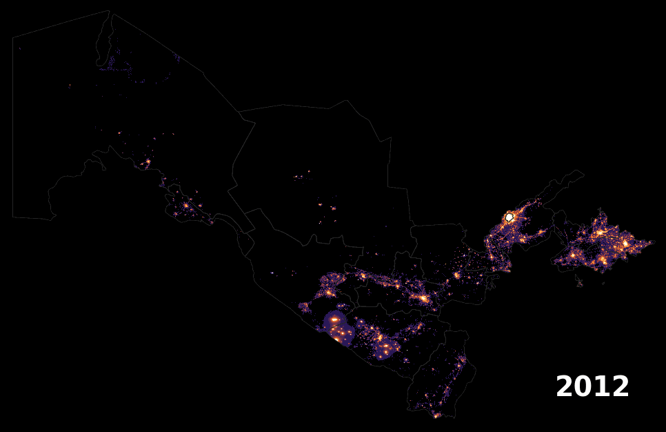

# ✨🌃 Day 17: Light & Dark — Uzbekistan at Night (2012–2025)

A multi-year nighttime satellite analysis of **Uzbekistan** using **NASA Black Marble (`VNP46A4`)** annual composites from **2012 to 2025** (`450 m` pixel resolution)—mapping how cities, Silk Road corridors, rural villages, and industrial sites light up across the dark desert and mountain landscape 🇺🇿🛰️

  

---

## 📊 Key Findings & Nighttime Light Trends (`2012–2025`)

### 1. Lit Area More Than Doubled After 2020 (`14,000` ➔ `30,800 km²`)
* **2012–2020 Transition:** Total lit area (`pixels > 1`, `~0.16 km²` per pixel) gradually dipped from **~18,500 km²** to **~14,000 km²**, reflecting reduced gas flaring alongside the nationwide transition from orange sodium streetlamps to white LED lighting (whose blue wavelengths are less sensitive to the VIIRS sensor).
* **2021–2025 Expansion:** Between 2021 and 2025, Uzbekistan's lit footprint more than doubled to **~30,800 km²**, driven by rapid urban growth, new highway lighting, industrial zones, and rural electrification.

### 2. Regional Brightness Growth (`2016` vs. `2025`)
* **Fastest-Growing Regions (Capped at `100` to prevent gas-flare distortion):** Every region recorded major nighttime growth between 2016 and 2025, led by **Surkhandarya (`+728%`)**, **Khorezm (`+473%`)**, **Samarkand (`+274%`)**, and **Jizzakh (`+231%`)**.
* **Urban Footprint Expansion:** Zooming into **Tashkent** (`68.9–69.75°E`, `41.0–41.55°N`) shows the city's glow expanding well beyond its municipal borders along corridors toward **Chirchiq**, **Angren**, and newly developed southern districts.
* **Industrial Gas Flares:** Persistent ultra-bright point anomalies in southern regions (such as Surkhandarya) highlight active oil and gas flaring visible from 800 km above Earth.

---

## 🛠️ Technical Workflow (`Python`)
* **Power-Law Radiance Stretch (`PowerNorm(0.4, vmin=0, vmax=40)`):** Compressed extreme city-center and gas-flare values (`> 20,000`) while stretching faint rural village radiance (`1–5`) onto a custom black–purple–orange–white ramp so both small settlements and major cities remain legible.
* **Pixel-by-Pixel Change & Zonal Aggregation (`rasterio` & `numpy`):** Computed decadal radiance differences (`2025 - 2016`) and summed capped regional brightness across all 14 administrative boundaries (`uzbekistan_regions.geojson`).
* **Animated Timelapse & Small Multiples (`matplotlib` & `Pillow`):** Exported both a 14-frame looping timelapse (`uzbekistan_at_night.gif`) and a `2 × 7` comparative poster (`uzbekistan_night_flipbook.png`).

---

## 📂 Folder Directory
* 🎞️ `uzbekistan_at_night.gif`: Animated 14-year nighttime timelapse (`2012–2025`).
* 🖼️ `uzbekistan_night_flipbook.png`: High-resolution `2 × 7` small-multiples grid poster (`2012–2025`).
* 📓 `day17_night_lights.ipynb`: Complete Python Jupyter Notebook with raster math, zonal statistics, and animation export.
* 📄 `README.md`: Project documentation and spatial findings.

---

## 🙏 Credits & Attribution
* **Nighttime Lights Data:** NASA Black Marble `VNP46A4` annual composites, Collection 2, LAADS DAAC (Román, M.O. et al., 2018, *Remote Sensing of Environment*, 210, 113–143).
* **Administrative Boundaries:** Uzbekistan regional boundaries (`uzbekistan_regions.geojson`).
* **Software:** Python (`rasterio`, `geopandas`, `numpy`, `pandas`, `matplotlib`, `Pillow`).

*Developed independently as part of the global #30DayMapChallenge.*
