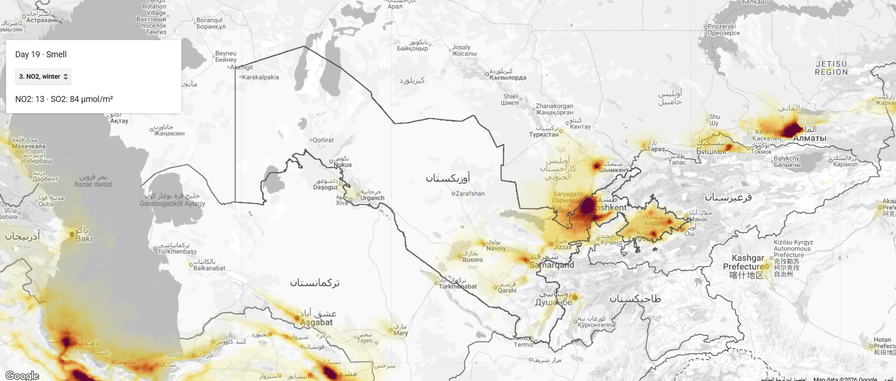
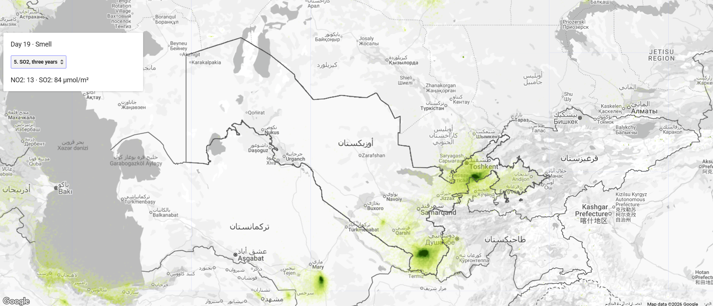
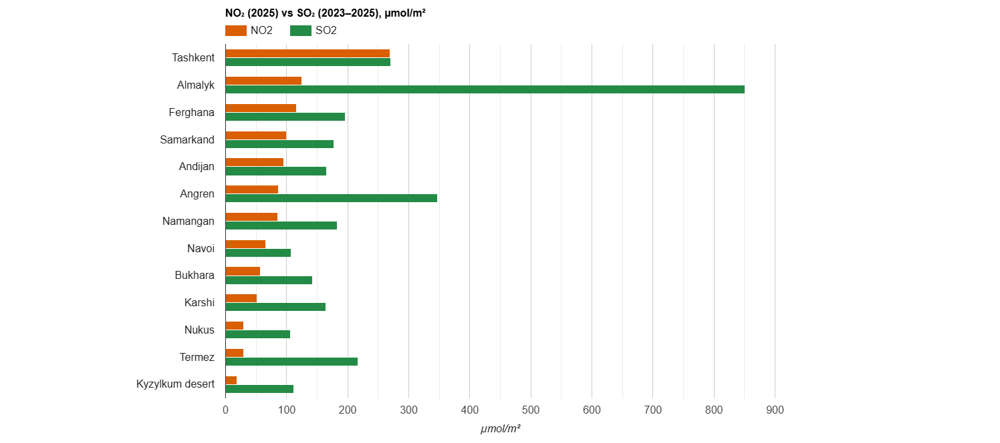

# 👃🛰️ Day 19: Senses: Smell — Air You Can Smell, Seen From Space (Uzbekistan)

An atmospheric remote sensing study of **Uzbekistan** using **Copernicus Sentinel-5P (`TROPOMI`)** in **Google Earth Engine**—mapping invisible trace gases you can actually smell: the sharp bite of **nitrogen dioxide ($\text{NO}_2$)** from urban traffic and winter heating, and the burnt-match odour of **sulphur dioxide ($\text{SO}_2$)** from copper smelting and sour natural gas flares 🇺🇿✨

🗺️ **[Explore the Interactive Map in Google Earth Engine](https://code.earthengine.google.com/4cab7eb64c6be08f9a2482b8687b9831)**

  
  

  
  

---

## 📊 Key Findings & Atmospheric Insights

### 1. Winter vs. Summer $\text{NO}_2$ (`Dec 2024–Feb 2025` vs. `Jun–Aug 2025`)
* **Nearly 3× Stronger in Winter:** In central **Tashkent**, tropospheric $\text{NO}_2$ averages **~456 $\mu\text{mol/m}^2$** in winter compared to **~159 $\mu\text{mol/m}^2$** in summer (versus **~17 $\mu\text{mol/m}^2$** over the clean Kyzylkum Desert).
* **Why Winter Air Traps Pollution:**
  * **Seasonal Heating:** Homes and thermal power plants burn significantly more natural gas and coal during winter months.
  * **Temperature Inversions:** Cold, stagnant winter air gets trapped beneath a warmer lid of air near the ground, preventing urban exhaust from dispersing.
  * **Sunlight Photochemistry:** Intense summer UV radiation breaks down $\text{NO}_2$ molecules within hours, whereas winter gases linger much longer.

### 2. Distinct Industrial Sources: $\text{SO}_2$ (`2023–2025` Mean)
* **Different Gases, Different Smells:** While **Tashkent** leads the nation in yearly $\text{NO}_2$ (**~270 $\mu\text{mol/m}^2$**), it produces very little $\text{SO}_2$. Instead, $\text{SO}_2$ concentrates sharply around two industrial hotspots:
  * **Almalyk:** Copper ore smelting at the **Almalyk Mining and Metallurgical Complex** releases sulphur-rich emissions.
  * **Surkhandarya:** Uzbekistan's strongest $\text{SO}_2$ plume originates from burning hydrogen-sulphide-rich ("sour") natural gas flares.

---

## 🛠️ Technical Workflow (`Google Earth Engine`)
* **Satellite & Units (`Sentinel-5P TROPOMI`):** Queried daily `OFFL/L3_NO2` (`tropospheric_NO2_column_number_density`) and `OFFL/L3_SO2` (`SO2_column_number_density`) at `5 × 3.5 km` pixel resolution, converting raw $\text{mol/m}^2$ values into micromoles per square metre ($\mu\text{mol/m}^2$).
* **Translucent "Smell Cloud" Styling:** Scaled gas intensity onto custom exhaust (`#f6e7a1` $\rightarrow$ `#5e1a3a`) and sulphur (`#eef2a0` $\rightarrow$ `#26410e`) palettes with square-root alpha masking (`updateMask(strength.sqrt())`) so clean desert air fades transparently into the basemap.
* **Zonal City Rankings & Time Series:** Sampled `7 km` buffers around 13 Uzbek cities and regions (`reduceRegions`) to compare yearly $\text{NO}_2$ and 3-year $\text{SO}_2$ side-by-side alongside a 36-month seasonal trend line.

---

## 📂 Folder Directory
* 🖼️ `NO2_winter.png`: Winter $\text{NO}_2$ concentration (`Dec 2024 – Feb 2025`).
* 🖼️ `NO2_summer.png`: Summer $\text{NO}_2$ concentration (`Jun – Aug 2025`).
* 🖼️ `SO2_three_years.png`: Three-year mean $\text{SO}_2$ hotspots (`2023 – 2025`).
* 📊 `combined_chart.png`: City-by-city $\text{NO}_2$ and $\text{SO}_2$ comparison chart ($\mu\text{mol/m}^2$).
* 📄 `README.md`: Project documentation and atmospheric findings.

---

## 🙏 Credits & Attribution
* **Satellite Data:** Contains modified Copernicus Sentinel-5P data (`2023–2025`), processed in Google Earth Engine (`COPERNICUS/S5P/OFFL/L3_NO2` & `L3_SO2`).
* **Administrative Boundaries:** US Department of State LSIB (`USDOS/LSIB_SIMPLE/2017`).
* **Software:** Google Earth Engine Code Editor.

*Developed independently as part of the global #30DayMapChallenge.*
